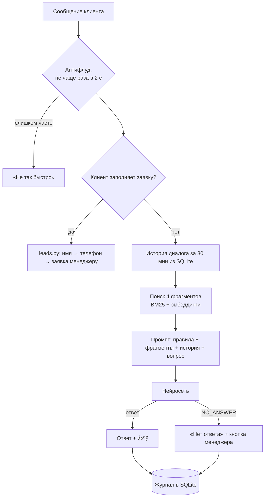

# AI Consultant Bot

Telegram-бот, который отвечает клиентам по документам компании с помощью нейросети (RAG), а вопросы без ответа превращает в заявки для менеджера.

## Что получает бизнес

| Проблема | Как решает бот |
|---|---|
| Менеджеры весь день отвечают на одни и те же вопросы про доставку и возврат | Бот отвечает за секунды и круглосуточно по документам компании |
| Нейросеть «выдумывает» условия, которых нет | Бот отвечает **только** по базе знаний; если ответа нет — честно говорит об этом |
| Клиент с нестандартным вопросом уходит | Бот предлагает оставить контакты и сразу присылает заявку менеджеру в Telegram |
| Непонятно, о чём спрашивают клиенты | `/stats` показывает количество вопросов, долю без ответа, оценки и **список вопросов, которых нет в базе** |

Пример диалога:

```
Клиент: сколько идёт доставка в Новосибирск?
Бот:    Курьером по Новосибирску — 1–2 дня, в пункт выдачи — от 2 до 7 дней.
        Заказ передаём в доставку в течение рабочего дня после оплаты.   [👍] [👎]

Клиент: а сколько это стоит?
Бот:    При заказе от 3000 рублей доставка бесплатная. Для заказов меньше:
        курьер — 390 рублей, пункт выдачи — 250 рублей.                  [👍] [👎]

Клиент: можно приехать к вам на склад?
Бот:    К сожалению, у меня нет точного ответа на этот вопрос. Оставьте контакты —
        менеджер свяжется с вами и всё подскажет.      [📞 Связаться с менеджером]
```

А менеджеру приходит:

```
🆕 Заявка #12
Имя: Анна
Телефон: +79001234567
Telegram: @anna_k
Последний вопрос: можно приехать к вам на склад?
```

---

## Быстрый старт

Нужен Python 3.10+.

```bash
python -m venv .venv
source .venv/bin/activate          # Windows: .venv\Scripts\activate
pip install -r requirements.txt
cp .env.example .env               # Windows: copy .env.example .env
```

Заполни `.env`:

| Переменная | Где взять |
|---|---|
| `BOT_TOKEN` | @BotFather → `/newbot` |
| `ADMIN_IDS` | свой id у @userinfobot |
| `LLM_API_KEY`, `LLM_BASE_URL`, `LLM_MODEL` | ключ OpenAI-совместимого API (OpenAI, OpenRouter, YandexGPT). Без ключа бот работает в демо-режиме и показывает найденный фрагмент как есть |
| `EMBEDDING_MODEL` | необязательно: включает смысловой поиск (например, `text-embedding-3-small`) |

```bash
python -m bot.main
```

Открой бота в Telegram и нажми «Старт». **Важно:** админ тоже должен один раз написать боту `/start` — Telegram не разрешает ботам писать первыми, иначе заявки не дойдут.

### Под своего заказчика

1. Замени файлы в `knowledge/` на документы заказчика: FAQ, условия доставки, прайс, регламенты. Поддерживаются `.md`, `.txt`, `.pdf`.
2. Поменяй `COMPANY_NAME` в `.env` и текст приветствия в `bot/handlers/questions.py` (`cmd_start`).
3. Отправь боту `/reload` — база переиндексируется без перезапуска.

**Совет по базе знаний:** Markdown с заголовками (`#`, `##`) работает лучше всего. Бот режет документы по разделам, и заголовок помогает найти нужный: вопрос «сколько идёт посылка» найдёт раздел «Сроки доставки».

---

## Команды

| Команда | Кто | Что делает |
|---|---|---|
| `/start`, `/help` | все | приветствие и подсказка |
| любой текст | все | вопрос к базе знаний |
| 📞 Связаться с менеджером | все | пошаговая заявка: имя → телефон (можно одной кнопкой «Отправить мой номер») |
| `/stats` | админы | статистика за 7 дней + вопросы без ответа |
| `/leads` | админы | последние 10 заявок |
| `/reload` | админы | перечитать папку `knowledge/` |

Для обычных пользователей админ-команд не существует: бот на них не реагирует.

---

## Как устроен проект

```
ai-consultant-bot/
├── bot/
│   ├── main.py             точка входа: собирает сервисы и диспетчер, запускает бота
│   ├── config.py           настройки из .env
│   ├── rag.py              ответ на вопрос: поиск → промпт → нейросеть → проверка
│   ├── llm.py              клиент нейросети и эмбеддингов (OpenAI-совместимый API)
│   ├── storage.py          SQLite: журнал вопросов, оценки, заявки, статистика
│   ├── keyboards.py        кнопки
│   ├── middlewares.py      антифлуд
│   ├── kb/
│   │   ├── loader.py       чтение .md / .txt / .pdf
│   │   ├── chunker.py      нарезка документов на фрагменты
│   │   └── retriever.py    поиск: BM25, эмбеддинги, гибрид
│   └── handlers/
│       ├── questions.py    /start, /help, вопросы, оценки 👍👎
│       ├── leads.py        заявка на конечном автомате (FSM)
│       └── admin.py        /stats, /leads, /reload
├── knowledge/              база знаний (пример — вымышленный магазин CozyHome)
├── tests/                  20 тестов, включая сквозные сценарии через диспетчер aiogram
├── Dockerfile, docker-compose.yml
└── .env.example
```

### Путь одного вопроса



### Что такое RAG и зачем он здесь

Нейросеть не знает условий доставки конкретного магазина. Дообучать её на документах долго и дорого, а при каждом изменении цен пришлось бы обучать заново. **RAG** (Retrieval-Augmented Generation) решает это проще: перед ответом бот находит в документах подходящие фрагменты и кладёт их в запрос с инструкцией «отвечай только по этому». Документы поменялись — достаточно `/reload`.

---

## Почему сделано именно так

### База знаний и поиск

**Документы режутся на фрагменты по заголовкам (`kb/chunker.py`).**
Всю базу в запрос не положить: это дорого, и модель теряется в длинном контексте. Режем сначала по заголовкам Markdown — раздел обычно посвящён одной теме. Путь заголовков («Доставка › Сроки») сохраняется в каждом фрагменте и участвует в поиске. Длинные разделы режутся по абзацам до ~900 символов, а соседние фрагменты перекрываются на один абзац, чтобы ответ на границе не разорвался.

**Два способа поиска и их комбинация (`kb/retriever.py`).**
- **BM25** — поиск по словам, как у классических поисковиков. Работает без API и бесплатно, хорошо находит точные термины («СБП», «Долями», артикулы). Не понимает синонимы: для него «стоит» и «стоимость» — разные слова.
- **Эмбеддинги** — поиск по смыслу: тексты превращаются в векторы, близкие по смыслу тексты дают близкие векторы. Понимает перефразирование, но нужен API.
- **Гибрид через Reciprocal Rank Fusion.** Баллы двух поисковиков в разных шкалах, складывать их нельзя. RRF смотрит только на места в выдаче: фрагмент, который высоко у обоих, побеждает. Так делают в продакшен-системах.

Без ключа эмбеддингов работает только BM25. Это осознанный компромисс: нейросеть получает 4 лучших фрагмента, и нужный почти всегда среди них, даже если он не первый (на это есть отдельный тест).

**Своя простая «морфология» вместо pymorphy.**
Слова обрезаются до 6 букв: «доставка», «доставки», «доставку» → «достав». Для FAQ этого хватает, а полноценный морфоанализатор добавил бы тяжёлую зависимость.

### Ответ нейросети

**Защита от выдуманных ответов (`rag.py`).**
Главный риск бота-консультанта — пообещать клиенту то, чего нет: скидку, бесплатную доставку, возврат через месяц. Поэтому в промпте жёсткое правило отвечать только по фрагментам. Если ответа нет, модель обязана вернуть маркер `NO_ANSWER`, и бот не импровизирует, а предлагает менеджера. Для бизнеса это ещё и источник заявок.

**Температура 0.2.** Консультанту нужна точность и одинаковые ответы на одинаковые вопросы, а не креативность.

**Уточняющие вопросы.** «А сколько это стоит?» само по себе не содержит темы. Поэтому поиск идёт по предыдущему вопросу + текущему, а в промпт добавляется история диалога за последние 30 минут (3 пары вопрос-ответ).

**Асинхронный клиент нейросети (`llm.py`).** Бот на aiogram работает в одном потоке. Синхронный запрос к нейросети на 5 секунд «заморозил» бы ответы всем остальным пользователям. С `AsyncOpenAI`, пока один клиент ждёт ответа, бот обслуживает других.

**Любой OpenAI-совместимый API.** Меняются только `LLM_BASE_URL` и `LLM_MODEL` в `.env`: OpenAI, OpenRouter, YandexGPT, локальная модель через Ollama.

### Telegram-часть

**Порядок роутеров важен (`main.py`).** aiogram проверяет роутеры по очереди: `admin` → `leads` → `questions`. Если поставить вопросы первыми, нажатие кнопки «Связаться с менеджером» ушло бы в нейросеть как вопрос.

**Заявка на конечном автомате (`handlers/leads.py`).** Бот помнит шаг диалога: ждёт имя → ждёт телефон. Без этого имя «Анна» ушло бы в нейросеть как вопрос. Вопросы обрабатываются только вне заявки (`StateFilter(None)`), на это есть отдельный тест.

**Телефон кнопкой.** Кнопка с `request_contact` подставляет номер из Telegram без опечаток. Введённый вручную номер приводится к виду `+7XXXXXXXXXX`.

**Менеджер получает контекст.** К заявке прикладывается последний вопрос клиента, чтобы менеджер не начинал разговор с «чем могу помочь?».

**Антифлуд только на вопросах (`middlewares.py`).** Каждый вопрос — платный запрос к нейросети. Без ограничения один человек с автокликером потратит баланс API за вечер. Шаги заявки не тормозятся: имя и телефон можно отправлять быстро. Предупреждение «не так быстро» приходит один раз, а не на каждое сообщение.

**Внедрение зависимостей.** Сервисы кладутся в диспетчер (`dp["rag"] = rag`), и aiogram сам передаёт их в обработчики по имени параметра. Обработчики не создают сервисы сами, поэтому в тестах их легко подменить.

**Роутеры создаются фабриками `setup()`.** Роутер можно подключить только к одному диспетчеру. Фабрика позволяет собрать новый бот в каждом тесте и не навешивать антифлуд дважды.

**Экранирование HTML.** Сообщения размечены HTML. Ответ нейросети или имя клиента с символом `<` или `&` без `html.escape()` сломали бы разметку, и Telegram отклонил бы сообщение.

**Кнопки оценки привязаны к пользователю.** В `storage.rate` проверяется `user_id`: подделав запрос, нельзя оценить чужой ответ.

### Хранение

**SQLite (`storage.py`).** Один файл, не нужен отдельный сервер. Журнал вопросов — главный инструмент улучшения бота: `/stats` показывает вопросы, на которые не нашлось ответа, и это готовый список того, что дописать в базу знаний.

**Шаги заявки в памяти (`MemoryStorage`).** При перезапуске бота незаконченные заявки сбрасываются. Для одного бота это нормально; при масштабировании на несколько серверов меняется на `RedisStorage` одной строкой.

---

## Docker

Docker упаковывает бота вместе с Python и библиотеками в «образ», который одинаково запускается на любом сервере. Не нужно ставить Python на сервер заказчика и разбираться с версиями.

```bash
docker compose up -d          # собрать и запустить в фоне
docker compose logs -f        # смотреть логи
docker compose restart        # перезапустить
docker compose down           # остановить
docker compose up -d --build  # пересобрать после изменения кода
```

Что важно в `Dockerfile` и `docker-compose.yml`:

| Строка | Зачем |
|---|---|
| `FROM python:3.12-slim` | облегчённый образ: ~50 МБ вместо ~350 МБ |
| `COPY requirements.txt` до `COPY bot` | Docker кеширует шаги: пока зависимости не менялись, пересборка после правки кода занимает секунды |
| `USER botuser` | бот работает не от root: меньше последствий, если в нём найдут уязвимость |
| `env_file: .env` | секреты подставляются при запуске и не попадают в образ |
| `restart: unless-stopped` | бот упал или сервер перезагрузился — Docker поднимет его сам |
| `volumes: ./data` | база SQLite лежит на сервере и переживает пересборку контейнера |
| `volumes: ./knowledge` | заказчик меняет документы на сервере и делает `/reload` без пересборки |
| `max-size: 10m` | логи не забьют диск сервера за год работы |

### Деплой на VPS

1. Арендуй VPS с Ubuntu (от 200–400 ₽/мес хватит), поставь Docker по официальной инструкции docs.docker.com.
2. `git clone` репозиторий, создай `.env`.
3. `mkdir -p data && sudo chown 1000:1000 data` — папка для базы должна принадлежать пользователю контейнера, иначе бот не сможет создать файл базы.
4. `docker compose up -d`.

---

## Тесты

```bash
pip install -r requirements-dev.txt
pytest -q
```

20 тестов, интернет не нужен. Кроме отдельных функций (нарезка, поиск, телефоны, антифлуд), есть **сквозные сценарии**: настоящий диспетчер aiogram получает поддельные сообщения из Telegram (`tests/conftest.py`, `FakeSession`), а тест проверяет, что бот ответил. Так проверяются маршрутизация, шаги заявки, отправка заявки менеджеру и закрытость админ-команд.

---

## Ограничения

- PDF-сканы без текстового слоя не читаются: их нужно распознать (OCR) заранее.
- Без эмбеддингов поиск не понимает синонимы. Для базы больше 20–30 страниц лучше включить `EMBEDDING_MODEL`.
- Индекс эмбеддингов строится в памяти при запуске. Для тысяч документов стоит перейти на векторную базу (Qdrant, pgvector).

## Идеи развития

- Голосовые сообщения: распознавание речи перед поиском
- Передача диалога живому оператору прямо в Telegram
- Веб-админка для загрузки документов
- Отправка заявок в CRM (amoCRM, Битрикс24) — через вебхук или n8n
